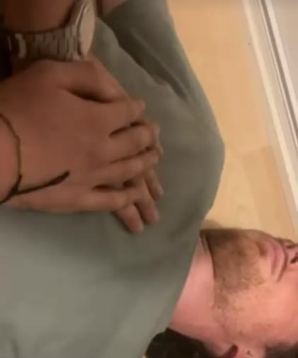
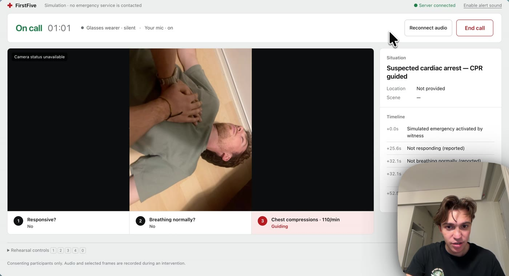
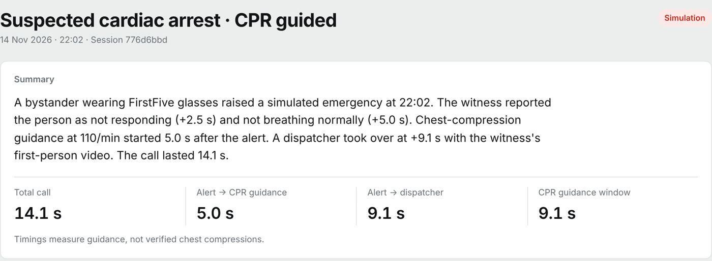
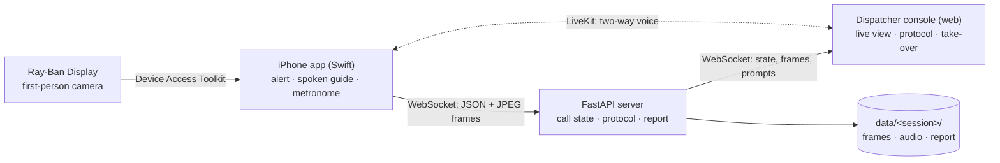

# FirstFive

**AI glasses that let an emergency dispatcher see what you see, while an AI voice guides your hands through the first five minutes of any emergency.**

Built in 48 hours at **Junction 2026** for Meta's *AI Glasses for Everyone, Everyday* challenge. Runs on real **Meta Ray-Ban Display** glasses through the **Wearables Device Access Toolkit**.

[](#tests)   

> **Simulation only.** FirstFive never contacts a real emergency service. Rehearse with consenting participants and a manikin or cushion.

[](https://www.youtube.com/watch?v=Uivl5qPupQU)

*▶ Watch the 2-minute demo: a real call with Ray-Ban Display glasses, from the alert to the handover report.*

| Try it | Where |
| --- | --- |
| 2-minute video of a real call on the glasses | **<https://www.youtube.com/watch?v=Uivl5qPupQU>** |
| Interactive demo in your browser (no install) | **<https://firstfive-demovercelapp.vercel.app/>** (source: [`demo-web/`](demo-web/)) |
| Full prototype on your machine (no glasses needed) | [Quickstart](#quickstart-no-glasses-needed) below |
| How it works inside | [docs/ARCHITECTURE.md](docs/ARCHITECTURE.md) |

---

## The problem

Every day, people face emergencies they were never trained for: a cardiac arrest, severe bleeding, choking, an earthquake. The first person on the scene is rarely a professional, and the minutes before help arrives decide the outcome. In a cardiac arrest, survival drops by up to 10% for every minute without CPR (American Heart Association).

Today the emergency dispatcher can only guide **by voice**. They cannot see the scene, and the witness needs **both hands**: a phone video call takes one away.

## What FirstFive does

| | |
| --- | --- |
|  | 1. **One tap raises the alert.** The glasses stream the witness's first-person view.<br><br>2. **An AI voice guides immediately**, before any human picks up: *"Is he responding?"*, *"Is he breathing normally?"*, then *"Push hard and fast, follow the beat"* with a 110/min metronome in the ear. Hands stay on the chest.<br><br>3. **The dispatcher takes over** with the live view and corrects what they see: *"Your hands are a bit high, lock your elbows."*<br><br>4. **A handover report is ready** when the ambulance arrives: timeline, timings, key frames, MIST handover. |

The live view, the guide and the take-over are generic. **Only the protocol changes** between emergencies: the prototype implements cardiac arrest end to end; bleeding, choking, burns, earthquakes and floods are designed and would each be a new step table on the server (see [`server/domain.py`](server/domain.py)).


*The dispatcher console during a real rehearsal call: the first-person view from the glasses, the protocol strip (step 3 guiding), the timeline, and the dispatcher on the line.*


*The report, generated only from what happened in the call. Timings measure guidance, not verified compressions, and the report says so.*

## Architecture



- **The server is the single source of truth** for the protocol step and every timestamp. Phone and console only render what it sends, so the guide can never advance twice and the report's timings come from one clock.
- **Voice runs peer to peer over LiveKit** (rooms scoped to the session, tokens valid 30 minutes, keys stay server-side), so a dropped control socket does not cut the call.
- Details, message protocol and state machine: [docs/ARCHITECTURE.md](docs/ARCHITECTURE.md).

## How the prototype answers the challenge brief

The brief asks for a prototype that *"handles permissions, errors, performance trade-offs, connectivity, and device state changes"*, with *"appropriate consent and safe data practices"*. Where to find each:

| Brief asks for | What FirstFive does | Evidence |
| --- | --- | --- |
| **Permissions** | Camera via the Meta DAT pairing flow; microphone and speech recognition requested in-app with explicit fallbacks to buttons if refused; local network to reach the server | [`ios/Sources/FirstFiveClient.swift`](ios/Sources/FirstFiveClient.swift) (`enableListening`, permission helpers) |
| **Errors** | JPEGs validated (format, 2 MB, 4 MP); answers checked against the active step; invalid payloads rejected with a message, never a crash; untrusted text escaped in the report | [`server/main.py`](server/main.py), tests `test_invalid_and_late_answers`, `test_read_only_and_bad_payload`, `test_report_escapes_untrusted_text` |
| **Performance trade-offs** | Frames downscaled to 800 px JPEG on the phone, ~15 fps, one frame in flight (natural back-pressure); server caps at 20 fps; a key frame every 10 s, max 60 per call; audio capped at 24 MB per track | [`FirstFiveClient.frame`](ios/Sources/FirstFiveClient.swift), [`server/main.py`](server/main.py) (`frame`, `keyframe`) |
| **Connectivity** | Phone WebSocket reconnects every 2 s; on reconnect the server re-sends the current prompt so the witness is never left in silence; voice survives a control-socket drop; audio upload retries are idempotent | tests `test_reconnecting_app_receives_current_prompt`, `test_images_reconnect_reset`, `test_audio_segments_are_retained_and_retry_is_idempotent` |
| **Device state changes** | Glasses session and stream state are pushed to the console badge; one producer at a time is enforced | `deviceStatus` in the iOS client, test `test_duplicate_producer_and_invalid_coordinates` |
| **Consent & safe data** | Nothing is recorded before the alert or after the call; data stays on the operator's machine (`data/`, git-ignored); optional access key with HTTP-only cookie; LiveKit secrets never leave the server; simulation banner always visible | [`server/main.py`](server/main.py), test `test_key_auth_and_cross_origin`, `test_livekit_missing_and_room_scoping` |
| **Inclusive interaction** | Voice, phone buttons, or the dispatcher answers for the witness; every spoken instruction is also shown as text on the phone panel and the projection view; high-contrast console where every state is written, never shown by color alone | [`ios/Sources/FirstFivePanel.swift`](ios/Sources/FirstFivePanel.swift), [`web/console.html`](web/console.html), [`web/caller.html`](web/caller.html) |

## Quickstart (no glasses needed)

Python 3.11+.

```sh
python3 -m venv .venv && . .venv/bin/activate
pip install -r requirements.lock
cp .env.example .env
uvicorn server.main:app --port 8000
```

Then open two tabs:

1. <http://localhost:8000/test-caller>: plays the witness (replaces the iPhone). Press **Emergency**, wait for the first question, answer **No**, **No**.
2. <http://localhost:8000/console?mode=operator>: the dispatcher. Watch the protocol strip light up, press **Answer call**, then **End call** and open the report.

Operator keys for rehearsals: `1` trigger · `2` yes · `3` no · `4` repeat prompt · `0` reset. Two-way voice needs LiveKit keys in `.env` (or a local LiveKit dev server, see [docs/ARCHITECTURE.md](docs/ARCHITECTURE.md#voice)); without them, everything else works and the console says voice is unavailable.

**On the glasses:** `python3 ios/prepare.py` generates Meta's official CameraAccess sample at a pinned revision and adds the FirstFive layer. See [`ios/README.md`](ios/README.md).

## Tests

```sh
pip install -r requirements-dev.txt
pytest -q          # 29 tests
ruff check .
```

They cover the full call scenario and persistence, both protocol branches, invalid and late answers, reconnection, upload validation and retries, report escaping, access-key auth, LiveKit room scoping, report survival across restarts, server-side timing, and the safe-update tooling. Browser end-to-end scripts (Playwright) are in [`tests/browser_smoke.py`](tests/browser_smoke.py) and [`tests/browser_voice.py`](tests/browser_voice.py).

## Repository map

| Path | Contents |
| --- | --- |
| [`server/`](server/) | FastAPI app: call hub and WebSockets (`main.py`), protocol and session model (`domain.py`), report (`reporting.py`), optional AI and transcription adapters (`llm.py`, `transcription.py`), Python simulator (`sim_app.py`) |
| [`web/`](web/) | Dispatcher console, projection view, browser witness simulator, report template |
| [`ios/`](ios/) | Swift layer added to Meta's CameraAccess sample (`Sources/`) and the generator `prepare.py` |
| [`demo-web/`](demo-web/) | Static, install-free interactive demo of the full call |
| [`tests/`](tests/) | Pytest suite and Playwright browser scripts |
| [`scripts/`](scripts/) | Mac launcher, safe updater that preserves Xcode signing and secrets, LiveKit helpers |
| [`video/`](video/) | Reproducible sources of the demo video (motion design as HTML, voice-over, edit filters) |
| [`docs/`](docs/) | [Architecture](docs/ARCHITECTURE.md), [product brief](PRODUCT.md), [development log](docs/dev-log/README.md) |

## Honest status

**Validated on hardware during the hackathon:** live stream from Ray-Ban Display glasses through the iPhone to the console; the cardiac arrest guide with its metronome; the dispatcher take-over; the report; two-way voice in the recorded demo.

**Known limits:** voice answers ("yes"/"no") work but are not reliable in a noisy room, so the demo uses a teammate pressing Yes/No; one active call per server; location and battery are not wired yet; the optional AI summary and transcription adapters are tested against mocked APIs only. Other emergencies are designed but not yet implemented as protocols.

## Roadmap to a pilot

1. **Training room:** dispatch trainers and CPR manikins, measured against voice-only calls (time to first compression, hand position corrected, compression rate in range).
2. **One dispatch centre:** opt-in volunteers who already wear AI glasses.
3. **Integration:** a link the dispatcher opens from the call software they already use.

Next on the product: bleeding, choking, burns, earthquake and flood protocols; alert from a tap on the glasses; real location; more languages; medical and GDPR review.
