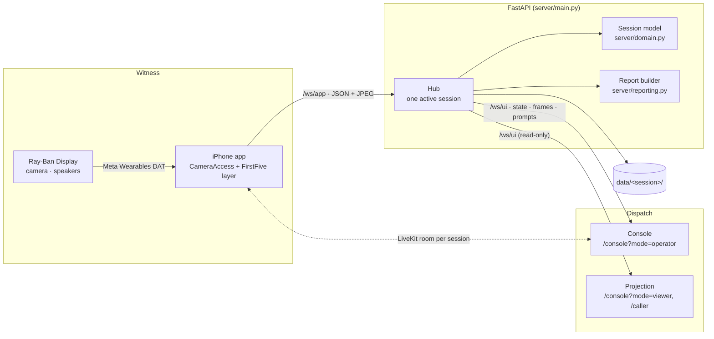
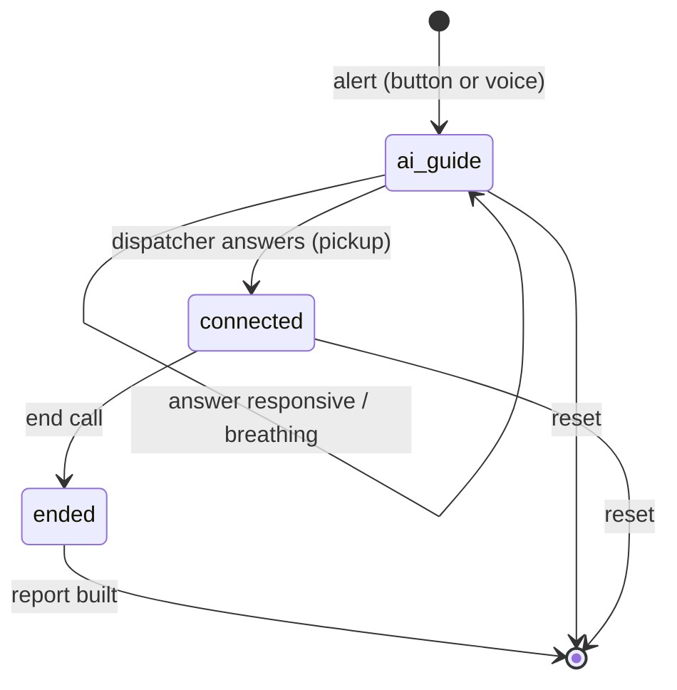

# FirstFive architecture

One FastAPI process owns the call. The iPhone app (attached to the glasses) produces video and answers; any number of browser consoles observe or operate. Voice travels separately over LiveKit.

## Why the server is authoritative

The guide step, every timestamp and every metric live on the server (`Session` in [`server/domain.py`](../server/domain.py)). Clients render what they receive and send *intents* (alert, answer, pickup, end). This gives:

- **No double progression:** an answer is accepted only if it matches the active step (`Session.answer` raises otherwise), so a late or duplicated tap cannot skip a question.
- **One clock:** "alert → CPR guidance" and "alert → dispatcher" in the report come from server time, not from phones with drifting clocks (test `test_metrics_use_server_time`).
- **Overrides:** a rehearsal operator can trigger, answer or repeat a prompt from the console; "repeat" never invents a medical answer.

## Call lifecycle

Inside `ai_guide`, the protocol for cardiac arrest is a small step table:

| Step | Spoken prompt | "No" leads to | "Yes" leads to |
| --- | --- | --- | --- |
| `responsive` | "Okay, I can see what you see. What's going on? Is he responding?" (sent 15 s after the alert so the witness can kneel first) | `breathing` | `stay` |
| `breathing` | "Is he breathing normally? Look at his chest." | `cpr` | `stay` |
| `cpr` | "Put your hands in the center of his chest. Push hard and fast, follow the beat." + 110/min metronome; after 10 s: "Keep going. A dispatcher is answering your call now." | | |
| `stay` | "A dispatcher is taking your call now." | | |

Another emergency is another table of steps and prompts; the transport, console, take-over and report do not change.

## WebSocket protocol

Producer (`/ws/app`, one at a time, enforced) → server:

| Message | Meaning |
| --- | --- |
| `{"type":"alert","trigger":"button"}` | Start a call |
| `{"type":"answer","step_id":"responsive","value":"no"}` | Witness answer for the active step |
| `{"type":"status","glasses":"connected","stream":"streaming"}` | Device state for the console badge |
| binary JPEG | A video frame (validated: JPEG, ≤ 2 MB, ≤ 4 MP; ≤ 20 fps) |

Consoles (`/ws/ui?role=operator|viewer`) → server: `pickup`, `end`, `dispatcher_said`, `override` (`trigger`, `answer_yes`, `answer_no`, `next_step`, `reset`). Viewers are read-only.

Server → everyone: `state` (phase, step, timeline, briefing card, device), `caller_heard` (the prompt or dispatcher caption to speak or show), `pickup`, `end`, `report_progress`, `report_ready`, `error`, plus binary frames to consoles.

On reconnect, a producer immediately receives the current prompt again (test `test_reconnecting_app_receives_current_prompt`), so a Wi-Fi hiccup never leaves the witness in silence. The iPhone ignores a repeat of the sentence it is already speaking, so a reconnect does not cut it off.

## Video path and trade-offs

| Stage | Choice | Why |
| --- | --- | --- |
| Phone | Downscale to 800 px, JPEG quality 0.5, up to 15 fps, one frame in flight | Smooth enough for a dispatcher to judge hand position, light on Wi-Fi (~300 KB/s), automatic back-pressure |
| Server | Validate, keep the latest frame, relay to consoles, store a key frame every 10 s (max 60) | The report gets evidence without storing a video file |
| Privacy | Frames are accepted only while a call is active | Nothing is captured before the alert or after the end |

## Voice

Two-way voice uses LiveKit. The server mints room tokens (`/livekit/token`, 30-minute TTL, room bound to the session id); API keys stay in the server's `.env`. The console records both tracks as segments with offsets relative to the alert and uploads them at the end; uploads are retried idempotently. Without LiveKit keys, the console shows that voice is unavailable and the rest of the call (video, guide, take-over, report) still works; dispatcher captions can be sent with the `dispatcher_said` message.

Local rehearsal without an account: `python3 scripts/install_livekit.py`, then run `.tools/livekit-server --dev` and start the server with `LIVEKIT_URL=ws://127.0.0.1:7880 LIVEKIT_API_KEY=devkey LIVEKIT_API_SECRET=secret` (LiveKit's public development values, loopback only).

## Report

[`server/reporting.py`](../server/reporting.py) builds the report from recorded events only: a plain-language summary, the four timings, key frames, MIST handover items each linked to the event that supports it, the timeline and the conversation. Optional adapters (`server/llm.py`, `server/transcription.py`) can add an AI draft and a transcript; without keys, or on any error, the deterministic report is kept and the gap is noted. Nothing is invented: a missing transcript is reported as missing. Untrusted text is escaped (test `test_report_escapes_untrusted_text`). Illustrative case details for rehearsals are tagged "Demo data" and can be disabled with `FIRSTFIVE_DEMO_REPORT=0`.

## Security posture of the prototype

- Optional shared access key (`FIRSTFIVE_ACCESS_KEY`): HTTP-only cookie for browsers, header for the phone; cross-origin WebSocket attempts rejected (test `test_key_auth_and_cross_origin`).
- Session data stays local in `data/` (git-ignored); no upload to third parties unless AI or transcription keys are configured.
- The safe updater refuses to overwrite signing settings, secrets, local data or symlinked paths (tests in `tests/test_update.py`).
- Not hardened for the public Internet: run it on a local network for rehearsals.
